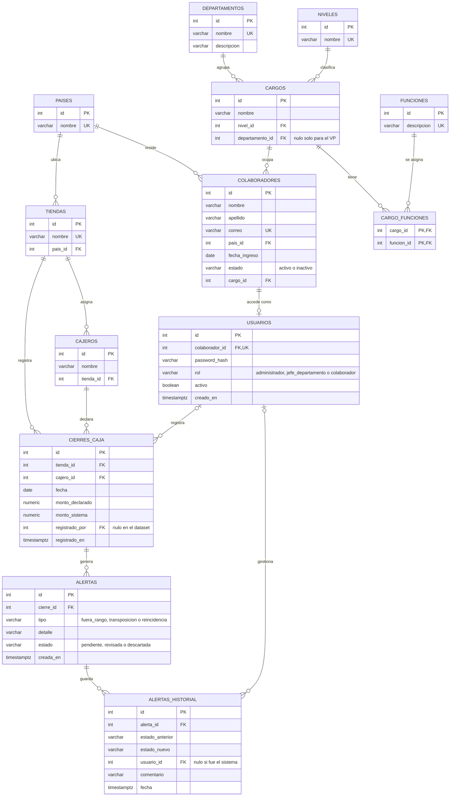

# Decisiones técnicas

Este documento explica las decisiones principales del Portal Corporativo de Finanzas: qué se
eligió, por qué y qué alternativas se descartaron. También deja escritos los supuestos, las
limitaciones conocidas y las mejoras a futuro.

## 1. Alcance

El enunciado pide un portal interno para la Vicepresidencia de Finanzas con:

- Un modelo relacional normalizado con al menos 4 departamentos, de 8 a 12 colaboradores por
  departamento y cargos con funciones, nivel y departamento.
- Inicio de sesión con tres roles (Administrador, Jefe de departamento y Colaborador) validados
  en el backend.
- Al menos tres módulos: dos de apoyo y uno que resuelva un proceso real de negocio.

Para el proceso real se eligió la **Opción 1: detector de anomalías en cierres de caja**. Tiene
reglas de negocio concretas que se pueden probar, y el resultado (alertas gestionables) se puede
mostrar de punta a punta. Los dos módulos de apoyo son **Organización** y **Cargos**, de solo
consulta.

La prioridad fue que la seguridad y el proceso de cierres funcionaran completos, antes que sumar
pantallas o funciones de edición.

## 2. Tecnologías

| Capa | Elección | Motivo |
|---|---|---|
| Base de datos | PostgreSQL | Relacional, con soporte sólido para restricciones (`CHECK`, `UNIQUE`, índices parciales), `NUMERIC` para montos y `TIMESTAMPTZ` para fechas con zona horaria. |
| Backend | Python + FastAPI | Validación de datos con Pydantic, inyección de dependencias para aplicar permisos en cada endpoint y documentación automática de la API en `/docs`. |
| Acceso a datos | SQLAlchemy 2 | Consultas parametrizadas (evitan inyección SQL) y modelos tipados. |
| Contraseñas | pwdlib con Argon2 | Argon2 es el algoritmo recomendado actualmente para guardar contraseñas. Se descartó passlib porque ya no tiene mantenimiento. |
| Sesión | PyJWT | Token firmado con la clave de `.env`. |
| Frontend | React + TypeScript + Vite | TypeScript detecta en compilación errores de tipos y de uso de librerías. |
| Interfaz | Material UI | Componentes accesibles y consistentes sin construir el sistema visual desde cero. |
| Pruebas | pytest | Pruebas de la API completa contra la base de datos real. |

## 3. Arquitectura

El backend está dividido por módulos (`auth`, `organizacion`, `cargos`, `cierres_caja`) y cada
módulo sigue las mismas capas:

| Archivo | Responsabilidad |
|---|---|
| `router.py` | Endpoints: recibe la petición, aplica los permisos y llama al servicio. |
| `service.py` | Reglas de negocio y decisiones de acceso por alcance. |
| `repository.py` | Consultas a la base de datos. |
| `models.py` | Tablas, como clases de SQLAlchemy. |
| `schemas.py` | Datos de entrada y salida de la API. |

Lo transversal vive en `app/core/`: configuración, conexión, seguridad y **permisos**. Todas las
reglas de acceso están en `core/permissions.py`, para que se apliquen igual en todos los módulos y
haya un único lugar que revisar.

Las reglas de detección de anomalías (`cierres_caja/rules.py`) son funciones puras: no consultan
la base de datos ni dependen de FastAPI. Se prueban aisladas y sus parámetros están definidos en
un solo lugar.

## 4. Modelo de datos

El esquema está en `database/schema.sql` y tiene 13 tablas en tres grupos.

GitHub dibuja el diagrama automáticamente. Las restricciones que el diagrama no muestra
(`CHECK`, `UNIQUE (nombre, departamento_id)` en cargos, `UNIQUE (cierre_id, tipo)` en alertas e
índices) se explican a continuación y están en el `schema.sql`.

**Estructura organizacional:** `paises`, `departamentos`, `niveles`, `cargos`, `funciones`,
`cargo_funciones` y `colaboradores`.

- **Países y niveles como catálogos.** Evitan repetir texto ("Venezuela", "Senior") en cada fila y
  los errores de escritura que eso trae.
- **Cargos con nivel y departamento.** Un colaborador tiene un cargo, y su departamento se obtiene
  a través de ese cargo. Así no se guarda el departamento dos veces y no puede quedar
  inconsistente.
- **Funciones como relación muchos a muchos.** Un cargo tiene varias funciones y una función puede
  repetirse en varios cargos (`cargo_funciones`).
- **El cargo de Vicepresidente de Finanzas no tiene departamento.** Dirige la Vicepresidencia
  completa, por encima de los departamentos. Para que ningún otro cargo quede sin departamento por
  error, un índice único parcial permite **un solo** cargo con `departamento_id` nulo.
- **`UNIQUE (nombre, departamento_id)` en cargos.** Evita cargos duplicados dentro de un mismo
  departamento.
- **Validaciones en la base de datos.** El correo es único y tiene un formato mínimo, y el estado
  del colaborador solo puede ser `activo` o `inactivo`.

**Acceso:** `usuarios`.

- Las credenciales están separadas de los datos del colaborador. Un colaborador puede existir sin
  acceso al portal, y la tabla de colaboradores nunca guarda contraseñas.
- El inicio de sesión requiere que el usuario esté activo **y** que el colaborador esté activo en
  la empresa.

**Cierres de caja:** `tiendas`, `cajeros`, `cierres_caja`, `alertas` y `alertas_historial`.

- Los montos son `NUMERIC(12,2)`, que es exacto (un tipo de punto flotante acumula errores de
  redondeo con dinero).
- `cierres_caja` guarda `tienda_id` además de `cajero_id`, porque así viene en la estructura del
  dataset y porque un cajero puede cubrir una tienda distinta a la asignada (ver supuestos).
- `registrado_por` es nulo en los cierres cargados desde el dataset y guarda al usuario en los
  cierres registrados desde el portal.
- `alertas` guarda el **estado actual** de cada alerta. `UNIQUE (cierre_id, tipo)` impide alertas
  duplicadas del mismo tipo para un cierre.
- `alertas_historial` guarda **cada cambio de estado**: de qué estado a cuál, quién, cuándo y con
  qué comentario. `usuario_id` nulo significa que lo hizo el sistema (la creación automática).

**Otras decisiones del esquema:**

- Los identificadores son `GENERATED BY DEFAULT AS IDENTITY`, el estándar SQL actual. Los datos
  semilla usan ids explícitos para que las referencias sean legibles, y al final se ajustan las
  secuencias.
- Índices en las columnas que más se consultan: cargos por departamento, colaboradores por cargo,
  cierres por cajero y fecha, alertas por estado e historial por alerta.
- **Scripts SQL en lugar de un sistema de migraciones (Alembic).** Para este alcance, dos archivos
  SQL legibles (`schema.sql` y `seed.sql`) son más fáciles de revisar y de ejecutar. Alembic tiene
  sentido cuando el esquema empieza a cambiar en un sistema con datos en producción.

## 5. Datos de ejemplo

- Los datos de tiendas, cajeros y cierres son los del dataset entregado, sin modificar los montos.
- Los 41 colaboradores, los departamentos y los cargos son ficticios: 10 colaboradores por
  departamento (uno de ellos inactivo) más la Vicepresidente de Finanzas. Los correos usan el
  dominio reservado `vpfinanzas.example`, que no puede pertenecer a nadie.
- La **administradora** es la Vicepresidente de Finanzas ficticia (Elisa Montero), porque el portal
  es de la Vicepresidencia. No se usó a ninguna persona real, en cumplimiento del enunciado.
- Los usuarios de prueba se crean con un script (`scripts/crear_usuarios.py`) y no con SQL, para
  que cada contraseña se guarde con su propio hash Argon2. La contraseña se toma de `DEMO_PASSWORD`
  en `.env` y debe tener al menos 12 caracteres.

## 6. Autenticación y seguridad

- **Contraseñas con Argon2** (pwdlib). Nunca se guardan ni se registran en texto plano.
- **Sesión en una cookie `httpOnly`** con `SameSite=Lax`. El JavaScript de la página no puede leer
  el token, lo que reduce el impacto de un ataque XSS. `COOKIE_SECURE=true` la limita a HTTPS
  cuando se despliegue.
- **El token solo contiene el id del usuario.** En cada petición el usuario se vuelve a leer de la
  base de datos, así que un cambio de rol o una desactivación tiene efecto inmediato.
- **Mensaje de error genérico al iniciar sesión.** No distingue entre "el correo no existe",
  "contraseña incorrecta" o "usuario inactivo", y se iguala el tiempo de respuesta con un hash
  ficticio, para no revelar qué correos están registrados.
- **Permisos validados en el backend.** El frontend solo oculta lo que el usuario no puede usar;
  escribir una URL a mano o llamar a la API directamente devuelve `403`.
- **Usuario de base de datos con privilegios mínimos.** La aplicación se conecta como `portal_app`,
  dueño solo de su base de datos, y no como `postgres`.
- **Secretos fuera del código.** La conexión, la clave del token y la contraseña de prueba se leen
  de `.env`, que está en `.gitignore`. El repositorio solo incluye `.env.example` con valores de
  ejemplo. La configuración falla al arrancar si falta un valor obligatorio.
- **CORS limitado** al origen del frontend (`FRONTEND_ORIGIN`).

## 7. Roles y alcance

| | Administrador | Jefe de departamento | Colaborador |
|---|---|---|---|
| Organización | Todos los departamentos, ficha completa | Su departamento, ficha completa (incluye inactivos) | Su departamento, datos de directorio (solo activos) |
| Cargos | Todos | Los de su departamento | Los de su departamento |
| Mi perfil | Sí | Sí | Sí |
| Cierres y alertas: consultar | Sí | Solo si es de Contraloría | Solo si es de Contraloría |
| Cierres y alertas: registrar y gestionar | Sí | Solo si es de Contraloría | No |

El módulo de cierres pertenece a Contraloría, el departamento que según su descripción revisa las
irregularidades de la operación. El backend también calcula qué módulos ve cada usuario
(`/auth/me`), de modo que el menú del frontend no decide permisos.

## 8. Detección de anomalías

### Reglas

| Regla | Condición | Alertas en el dataset |
|---|---|---|
| Fuera de rango | La diferencia entre lo declarado y el sistema supera el **1 %** del monto del sistema, en cualquier dirección (faltante o sobrante). | 18 |
| Transposición | Los montos solo difieren en **dos dígitos contiguos intercambiados** (por ejemplo, 573,95 y 753,95). | 5 |
| Reincidencia | El mismo cajero acumula **3 o más cierres con anomalía en 30 días**, contando el cierre analizado. | 3 |

- **Medir en porcentaje y no en montos fijos.** Una misma diferencia no pesa igual en una tienda
  pequeña que en una grande; el porcentaje las compara en las mismas condiciones.
- **Umbral del 1 %.** Es un criterio propio: una diferencia pequeña puede ser un redondeo o un
  error menor de conteo, y lo que pasa del 1 % merece revisión. Se comprobó con el dataset: los
  cierres normales no superan el 0,70 % de diferencia y las anomalías empiezan en 2,2 %, así que
  el 1 % separa los dos grupos con margen.
- **Transposición solo con dígitos contiguos.** Se descartó el atajo "la diferencia es múltiplo de
  9": es una condición necesaria pero no suficiente, y en el dataset marcaría como transposición
  los cierres 15, 35 y 47, que no lo son.
- **Reincidencia sin alertas descartadas.** Si Contraloría descarta una alerta (por ejemplo, un
  error de digitación ya corregido), esa anomalía deja de contar para la reincidencia.
- Un cierre puede tener varias alertas de tipos distintos.

### Cuándo se analiza

- Cada cierre nuevo se analiza **en la misma transacción** en que se registra: o se guardan el
  cierre y sus alertas, o no se guarda nada.
- Los cierres del dataset se analizan una vez con `scripts/analizar_cierres.py`, en orden
  cronológico, para que la reincidencia se evalúe igual que si se hubieran registrado día a día.
  El análisis es idempotente: ejecutarlo de nuevo no duplica alertas.

### Gestión de alertas

- Toda alerta nace `pendiente` y queda registrada en el historial como acción del sistema.
- Solo se puede pasar de `pendiente` a `revisada` o `descartada`, y el comentario es obligatorio.
  Una alerta ya gestionada no se puede volver a cambiar (`409`), para que la decisión no se
  sobrescriba sin rastro.
- La fila de la alerta se bloquea mientras se actualiza (`SELECT … FOR UPDATE`), para que dos
  personas no la gestionen a la vez.

## 9. Frontend

- **Mismo origen gracias al proxy de Vite.** El frontend llama a `/api/...` y Vite lo redirige al
  backend. La cookie de sesión funciona sin configurar cookies entre dominios.
- **La sesión se consulta al backend** (`/auth/me`) al cargar la aplicación. El usuario, sus
  módulos y sus permisos vienen del servidor; el frontend no guarda el token.
- **Componentes compartidos** para títulos, tablas, estados de carga y error, y formato de montos
  y fechas, para que todas las pantallas se comporten igual.
- **Diseño:** paleta de azules de la marca, tipografías instaladas con npm (no dependen de
  servicios externos) y tablas que se desplazan por dentro en lugar de mover la página completa.

## 10. Pruebas

- 59 pruebas automatizadas con pytest: inicio de sesión, control de acceso por rol y alcance,
  reglas de detección, registro de cierres y gestión de alertas.
- Cada prueba corre dentro de una transacción que se deshace al terminar. Las pruebas pueden
  registrar cierres y gestionar alertas sin modificar los datos de la base local, y se pueden
  repetir siempre con el mismo resultado.
- Las pruebas de detección verifican las alertas exactas que genera el dataset (cuáles cierres y
  cuáles cajeros), no solo su cantidad.

## 11. Supuestos y limitaciones

- **Cierres repetidos por cajero y fecha.** La documentación del dataset dice "un cierre por
  cajero/fecha", pero el dataset tiene 6 pares de cierres con el mismo cajero y la misma fecha. No
  se agregó una restricción `UNIQUE` que los datos no cumplen, ni una regla que los trate como
  anomalía, porque el enunciado no lo pide. Queda como mejora a futuro.
- **Un cajero puede cerrar en otra tienda.** El formulario propone la tienda asignada al cajero,
  pero permite cambiarla para cubrir el caso de un cajero que trabaja en otra tienda ese día. Las
  reglas no cambian: la reincidencia se cuenta por cajero, sin importar la tienda.
- **Moneda.** El dataset tiene tiendas en Venezuela y Argentina. Las reglas comparan montos dentro
  de un mismo cierre y usan porcentajes, así que no necesitan convertir monedas. Un reporte que
  sume montos de varios países sí lo necesitaría.
- **Umbrales globales.** El 1 %, los 3 cierres y los 30 días son iguales para todas las tiendas.
- **Módulos de apoyo de solo consulta.** Organización y Cargos no permiten crear ni editar datos.
  Los usuarios se crean con un script.
- **Cierre de sesión.** Cerrar sesión borra la cookie, pero el token sigue siendo válido hasta que
  vence (30 minutos por defecto) si alguien lo hubiera copiado. La desactivación de un usuario sí
  tiene efecto inmediato.
- **Ejecución local.** El proyecto está preparado para ejecutarse en local, como pide el
  enunciado; no incluye configuración de despliegue.

## 12. Mejoras a futuro

**Datos y modelo**
- Reemplazar `paises` por una tabla jerárquica `lugares` (país, estado, ciudad) con referencia a sí
  misma, si se necesita más detalle geográfico.
- Modelar la asignación de cajeros a tiendas con fechas, para registrar formalmente las coberturas.
- Definir con el negocio qué hacer con varios cierres del mismo cajero en un día: restricción,
  turnos o una regla de alerta.

**Funcionalidad**
- Gestión de usuarios desde el portal, con contraseñas temporales que se cambian en el primer
  ingreso.
- Edición de colaboradores con auditoría de cada cambio.
- Recibir los cierres directamente del sistema de caja de las tiendas.
- Notificar por correo al responsable cuando se genera una alerta.
- Tablero de alertas por tienda, ciudad y país.
- Umbrales configurables por tienda.

**Operación y seguridad**
- Docker Compose para levantar base de datos, backend y frontend con un solo comando.
- Sesiones guardadas en el servidor para poder revocarlas al instante.
- Un gestor de secretos en producción en lugar de `.env`.
- Usuarios de base de datos separados para migraciones y para la aplicación.
- Migraciones versionadas (Alembic) cuando el esquema empiece a evolucionar con datos reales.
